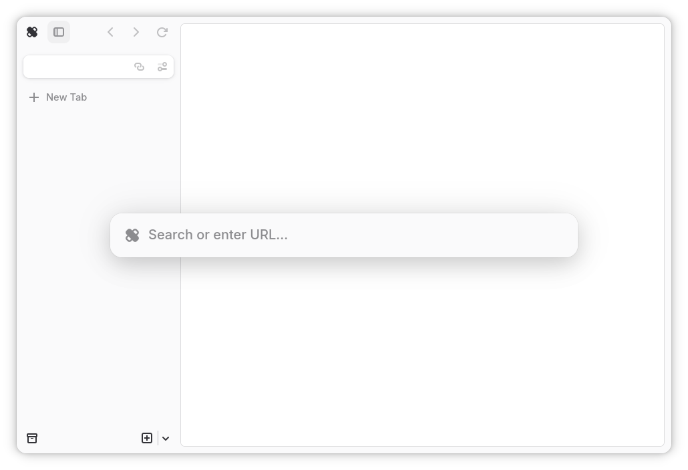
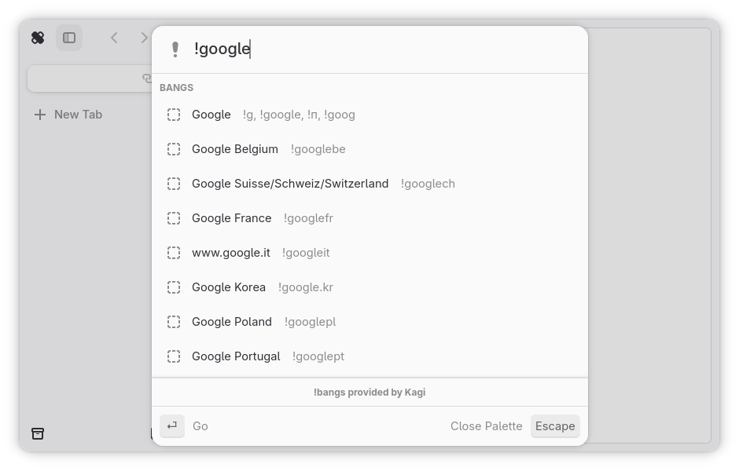
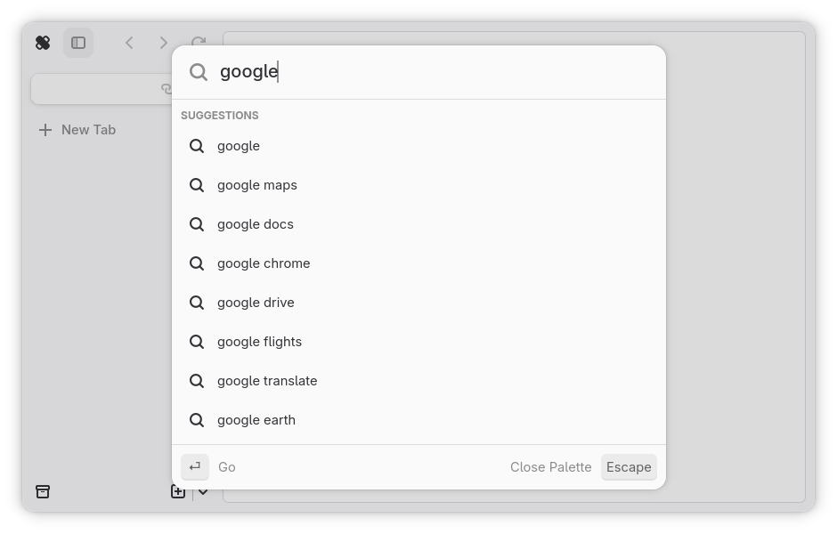

# Command Palette

The command palette is the main way of getting around Ouch Browser, and the
first element displayed on startup. Think of it as the search bar of a
conventional web browser, but contains more features. Command palette includes
support for !bangs and search autocompletion out of box, which can both be
disabled inside [preferences](preferences.md). The command palette can be
summoned using <kbd>Ctrl</kbd> + <kbd>T</kbd> for a new tab, <kbd>Ctrl</kbd> +
<kbd>L</kbd> or <kbd>Alt</kbd> + <kbd>D</kbd> to change the current tab's URL
(considered the *de-facto* main way to summon the palette).

## !bangs

!bangs help you search websites that are not conventional search engines.
!bangs are provided as-is via Kagi, with the exception of a handful of
Kagi-specific !bangs, and are stored internally and updated with each update.
More parity comparisons and tradeoffs can be found in
[BANGS.md](https://codeberg.org/shrimple/OuchBrowser.NET/src/commit/9cdcff3a7f0515ddf1ba4518f5c886aa729c1824/BANGS.md)

## Search

Search allows you to search the internet using the search engine selected in
[preferences](preferences.md#enable-search-autocomplete).
Due to technical limitations, the command palette only fetches autocomplete
results from DuckDuckGo. Autocompletion can be disabled in preferences.
